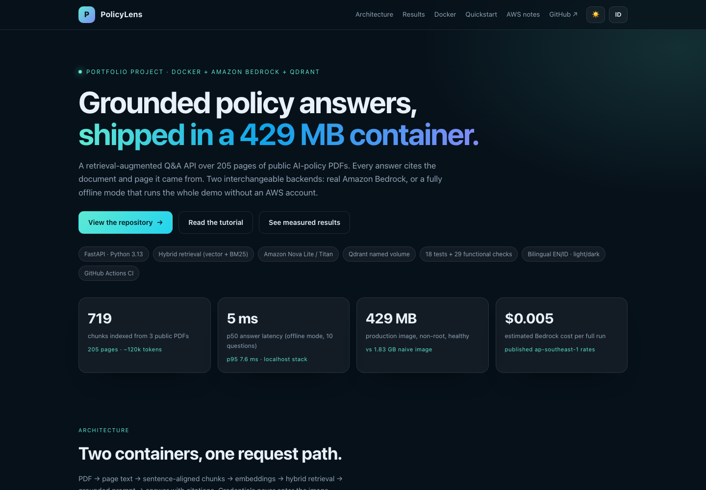
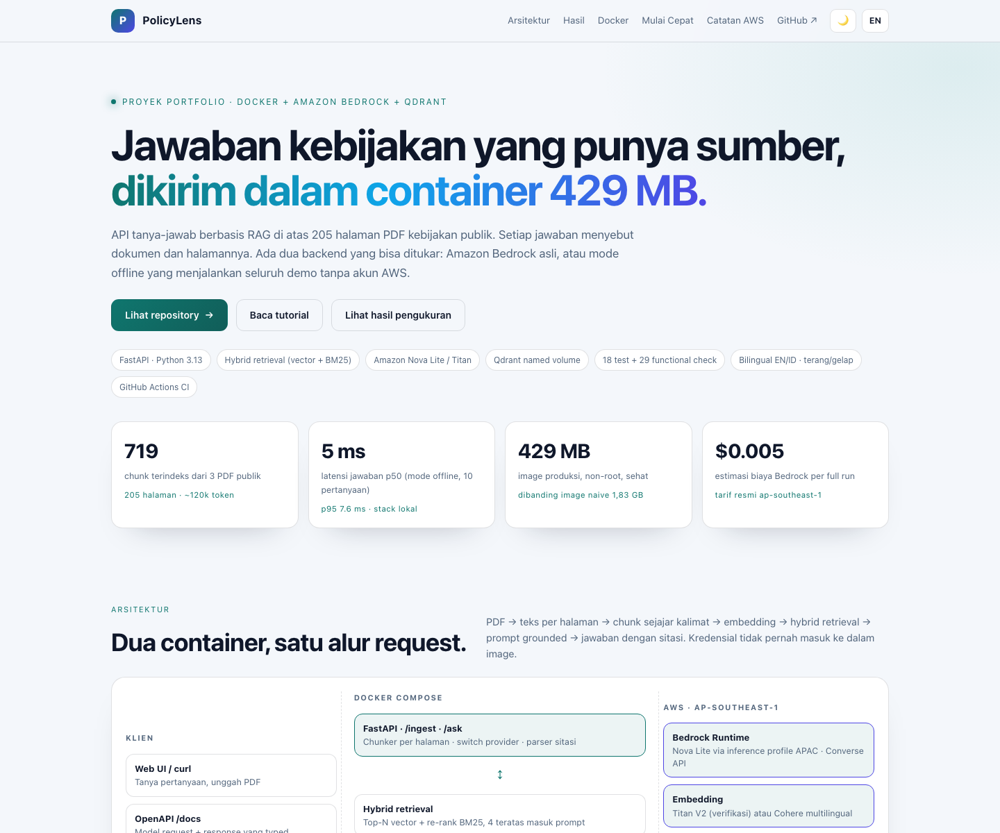
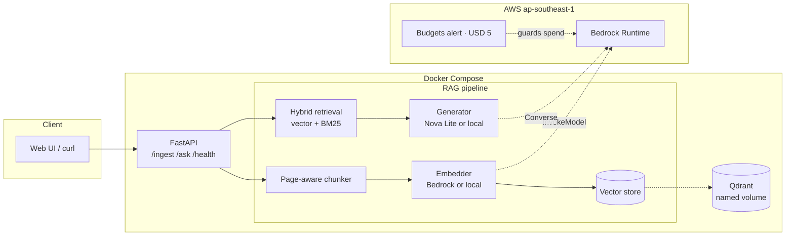
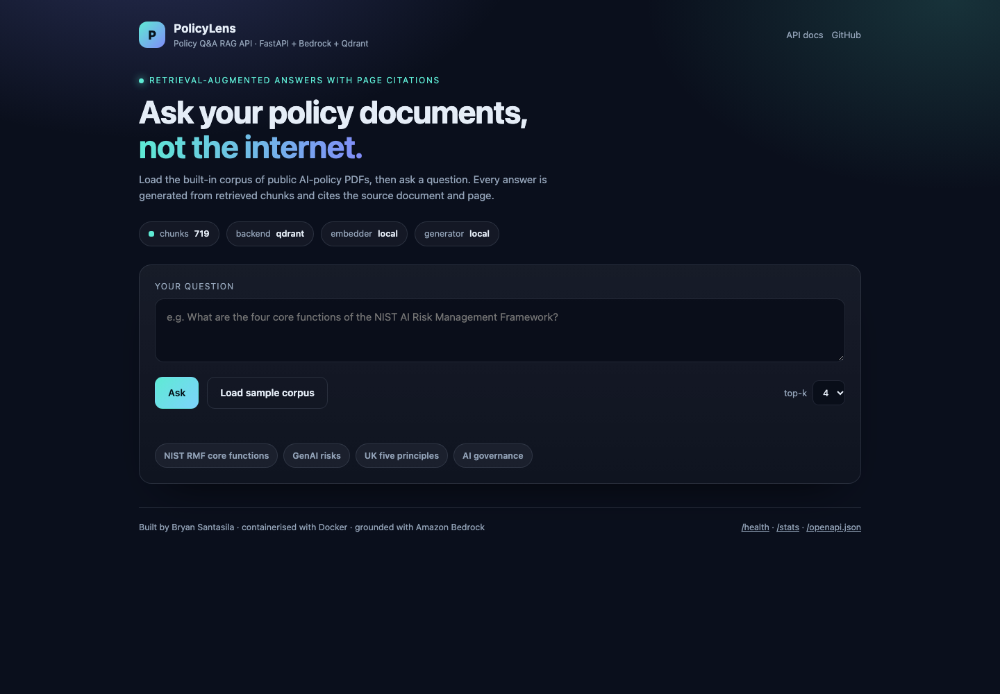

# PolicyLens — Policy Q&A RAG API on Amazon Bedrock, in Docker

A grounded question-answering API over public AI-policy documents. Upload PDFs, ask a
question, and get an answer with **page-level citations** — running as a small, hardened
Docker image with a Qdrant vector store.

Built as a portfolio project for Data Science / Solutions Architect roles: the interesting
part is not the demo, it is the engineering decisions around retrieval, container size,
credential handling and reproducible evaluation.


**Repo:** https://github.com/SBryanK/DOCKER-AWS-TRIAL
**Website:** https://sbryank.github.io/DOCKER-AWS-TRIAL/
**API (local):** http://localhost:8000 · **Swagger:** http://localhost:8000/docs



<details>
<summary>Light theme · Bahasa Indonesia</summary>



</details>

---

## What it does

- `POST /ingest` (PDF/TXT/MD upload) or `POST /ingest/sample` chunks page-aware documents
  and stores vectors (numpy index locally, Qdrant in compose).
- `POST /ask` embeds the question, retrieves candidates, re-ranks with BM25 (hybrid
  retrieval), and answers with inline `[n]` citations + a source/page list.
- Two interchangeable providers:
  - **Bedrock mode** — Titan/Cohere embeddings + Amazon Nova Lite via the Converse API.
  - **Offline mode** — deterministic hashed embeddings + an extractive answerer. No AWS
    account needed; used for the live demo, CI and tests.
- `GET /health`, `GET /stats`, and a small built-in web UI at `/`.

## Architecture



Request path: **PDF → page text → overlapping sentence-aligned chunks → embeddings →
vector index → question embedding → hybrid retrieval → grounded prompt → answer +
citations**. Credentials are read from the host's AWS profile at runtime and never enter
the image.

## Quickstart (no AWS account needed)

```bash
git clone https://github.com/SBryanK/DOCKER-AWS-TRIAL.git
cd DOCKER-AWS-TRIAL
docker compose up --build -d

# wait for both containers to be healthy
docker compose ps

# index the 3 bundled policy PDFs (205 pages) into Qdrant
curl -X POST http://localhost:8000/ingest/sample

# ask
curl -X POST http://localhost:8000/ask \
  -H 'Content-Type: application/json' \
  -d '{"question":"What are the four core functions of the NIST AI Risk Management Framework?","top_k":4}'
```

Open http://localhost:8000 for the demo UI, http://localhost:8000/docs for OpenAPI.



The site is **bilingual (English / Indonesian)** with **light and dark themes**,
switchable from the top-right corner. Measured on the author's machine (Apple M5 Pro,
Docker Desktop): ingest **2.0 s** for 205 pages / 719 chunks; the compose/Qdrant stack
answers in **~5 ms** p50 in offline mode.

### Local development (without Docker)

```bash
uv venv --python 3.13 .venv
uv pip install --python .venv/bin/python -r requirements-dev.txt
cp .env.example .env                 # offline defaults
.venv/bin/python -m scripts.ingest   # build the numpy index
.venv/bin/uvicorn app.main:app --reload --port 8000
.venv/bin/pytest                     # 18 tests
.venv/bin/python -m scripts.functional_test   # 29 end-to-end API checks (API must run)
```

## Bedrock mode (real model calls)

Prerequisites: an AWS account, a local CLI profile (`aws configure sso`), and a **USD 5
monthly budget alert** before the first call.

```bash
# 1) Create the budget alert (run locally, never inside the image)
python -m scripts.setup_budget --email you@example.com --amount 5

# 2) Verify identity, model IDs, inference profiles and quotas from your account
python -m scripts.check_bedrock --profile your-sso-profile
#    Lists what ap-southeast-1 actually offers; makes one tiny embedding
#    and one Converse call, and prints token usage.

# 3) Run the API in Bedrock mode (host creds mounted read-only)
EMBEDDINGS_PROVIDER=bedrock LLM_PROVIDER=bedrock \
AWS_PROFILE=your-sso-profile \
  docker compose up --build -d

# 4) Re-run the evaluation with real models
python -m scripts.run_eval --base-url http://localhost:8000
```

The API is identical in both modes; only `EMBEDDINGS_PROVIDER` / `LLM_PROVIDER` and the
model IDs change. AWS facts and the exact IDs to verify are documented in
[docs/AWS_NOTES.md](docs/AWS_NOTES.md) — including a model that **reached end-of-life two
weeks before this project was built**, which is why the repo ships a verification script
instead of hard-coding trust in an old tutorial.

## API

| Method | Path | Description |
|---|---|---|
| `GET` | `/` | Demo web UI |
| `GET` | `/health` | Liveness + chunk count + backends |
| `GET` | `/stats` | Corpus, models, chunking, region |
| `POST` | `/ingest` | Multipart PDF/TXT/MD upload (`files`, optional `reset`) |
| `POST` | `/ingest/sample` | Ingest the bundled `data/policies` corpus |
| `POST` | `/ask` | `{"question": "...", "top_k": 4}` → grounded answer + citations |
| `GET` | `/docs` | OpenAPI/Swagger UI |

All endpoints are also covered by `scripts/functional_test.py` (29 checks: happy paths,
validation errors, uploads, reset semantics, grounded refusals, corpus restore).

<details>
<summary>Example <code>/ask</code> response (abridged)</summary>

```json
{
  "answer": "Based on the ingested documents: ... four functions: GOVERN, MAP, MEASURE, and MANAGE [2].",
  "citations": [
    {
      "chunk_id": "6dc700bf42ce",
      "source": "nist-ai-rmf-1.0.pdf",
      "page": 8,
      "score": 0.87,
      "snippet": "These functions – GOVERN, MAP, MEASURE, and MANAGE ...",
      "used": true
    }
  ],
  "usage": {"input_tokens": 0, "output_tokens": 0, "embedding_tokens": 11},
  "latency_ms": 15.0,
  "mode": "local-extractive",
  "model": "local-extractive/1",
  "grounded": true
}
```

</details>

## Sample corpus

| Document | Publisher | Pages |
|---|---|---|
| NIST AI Risk Management Framework 1.0 | NIST (US) | 48 |
| NIST Generative AI Profile (AI 600-1) | NIST (US) | 64 |
| A pro-innovation approach to AI regulation | UK DSIT (OGL v3) | 93 |

**205 pages · 482,817 chars (~120k tokens) · 719 chunks.** Source URLs, checksums and
licensing: [data/SOURCES.md](data/SOURCES.md).

## Evaluation

`python -m scripts.run_eval` → [eval/report.md](eval/report.md). Ten questions with an
expected document and expected terms, measured client-side.

| Metric | Result |
|---|---|
| Questions | 10 |
| Latency p50 / p95 | **4.8 ms / 7.6 ms** |
| Expected source retrieved in top-4 | **100%** |
| Expected source actually cited | **100%** |
| Answers with ≥1 used citation | **100%** |
| Grounded flag | **100%** |
| Expected-term coverage | **58%** |

**Read this honestly.** These numbers were produced in **offline extractive mode**
(deterministic hashed embeddings + sentence-copying answerer) on the compose/Qdrant
stack, because no AWS credentials were available in the build environment.
Retrieval/citation metrics describe the RAG plumbing; the 58% term coverage exposes the
ceiling of a lexical fallback — it copies sentences rather than answering fluently.
Bedrock mode must be re-measured with real credentials (`scripts/run_eval`) before
quoting answer-quality numbers. No AWS cost was incurred during this build.

## Docker engineering (measured)

| | Naive `docker/Dockerfile.naive` | Production `Dockerfile` |
|---|---|---|
| Base | `python:3.13` (full) | `python:3.13-slim`, multi-stage |
| User | root | `app` (uid 10001) |
| Healthcheck | none | yes (`/health`) |
| Build cache | one layer | deps cached before app code |
| **Image size** | **1.83 GB** | **429 MB** (−77%) |

Layer-cache behaviour measured on the production image:

- no-change rebuild: **1.79 s**
- app-code change (`COPY app`): **0.78 s**
- dependency change (`pip install`): **10.65 s**

Named-volume persistence demonstrated live: after `docker compose restart` **and**
`docker compose down && docker compose up -d`, the API still reports **719 chunks** and
Qdrant still holds **719 points**. `docker compose down -v` would delete them.

Security choices: no keys in the image or repo (`.env`, `.aws` ignored), credentials
mounted read-only at runtime only, non-root user, `HEALTHCHECK`, upload size/type limits,
pinned dependencies, no host bind-mounts for data. The demo API has no authentication —
a deliberate, documented trade-off (see below).

## Cost

Rates below are from the **AWS Price List API for ap-southeast-1** (publication date
2026-11-23) and the official Bedrock model cards; see [docs/AWS_NOTES.md](docs/AWS_NOTES.md)
for citations and unverified items.

| Item | Rate |
|---|---|
| Amazon Nova Lite — input | $0.081 / 1M tokens |
| Amazon Nova Lite — output | $0.324 / 1M tokens |
| Titan Text Embeddings V2 — input | $0.028 / 1M tokens |
| Nova Micro — input / output (profile unverified) | $0.047 / $0.188 per 1M |

Estimated cost of one full run (ingest 120k tokens + 10 questions with ~1.1k input and
~200 output tokens each): **≈ $0.005**. A USD 5/month AWS Budget alert is mandatory before
the first call (`scripts/setup_budget.py`). Budgets themselves are free.

## Trade-offs (and what I would change at enterprise scale)

| Decision | Why | Production change |
|---|---|---|
| Character-based, 900-char chunks | dependency-free, fast, easy to reason about | token-based chunking + section-aware splits; evaluate chunk sizes |
| numpy brute-force index locally | zero infra for the demo | managed vector DB (OpenSearch, Aurora pgvector, Qdrant cluster) |
| Hashed lexical embedder offline | demo + CI without AWS | Bedrock embeddings are the production path |
| BM25 re-rank over whole corpus in offline/numpy mode | recovers rare-term matches cheaply | dedicated BM25 index, cross-encoder reranker |
| Single FastAPI process, sync ingestion | simple | async job queue + S3 event ingestion, idempotent re-indexing |
| No auth / rate limiting | portfolio scope | API Gateway + Cognito/JWT, quotas, WAF |
| Logs only | demo scope | OpenTelemetry traces, token/cost metrics, groundedness evals |
| `docker compose` | lowest barrier for reviewers | ECS Fargate or EKS, IaC (Terraform/CDK), blue/green deploys |

Enterprise additions worth calling out in an interview: data residency (the `apac.`
inference profile can route to Tokyo/Seoul/Osaka/Mumbai/Sydney — not strictly Singapore),
Bedrock Guardrails, PII redaction before embedding, per-tenant index isolation, and
retrieval evaluation in CI with a golden set.

## Model availability gotchas (verified from AWS docs, Nov 2026)

- ✅ `apac.amazon.nova-lite-v1:0` — Nova Lite is reachable from Singapore via the APAC
  cross-region inference profile; Converse is supported. This is the default generator.
- ⚠️ `amazon.titan-embed-text-v2:0` — the Singapore price list lists it, but the model
  card's regional table does not. **Docs conflict → verify in the console** with
  `scripts/check_bedrock.py`. The code also supports `cohere.embed-multilingual-v3`
  (verified in-region) as a fallback.
- ❌ `anthropic.claude-3-haiku-20240307-v1:0` — reached end-of-life in ap-southeast-1 on
  **2026-11-13**; calls now fail with `ResourceNotFoundException`. Do not copy old blog
  posts.
- ⚠️ Nova Micro has no published `apac.` profile ID; unverified.
- Commercial regions do not require a "Model access" request click (that is GovCloud);
  first use auto-subscribes, and IAM needs `bedrock:InvokeModel`.

## Repo layout

```
app/                 FastAPI app, chunking, embeddings, LLM, vector store, UI
scripts/             ingest CLI, eval runner, functional tests, Bedrock verifier, budget/cleanup
tests/               18 pytest tests (chunking, retrieval, API, persistence)
data/policies/       3 public PDFs + provenance/checksums
eval/                10 questions, results.json, functional_results.json, report.md
docs/                GitHub Pages website + AWS notes
Dockerfile           production multi-stage image
docker/              deliberately naive baseline Dockerfile
docker-compose.yml   API + Qdrant + named volumes
```

## AWS resources and cleanup

This project creates **no persistent AWS resources** by itself: Bedrock is pay-per-token.
The optional budget alert is the only account-level object the scripts create, and it was
**not created here** because no AWS credentials were configured in the build environment.

```bash
python -m scripts.cleanup_aws                    # inspect budgets + manual checklist
python -m scripts.cleanup_aws --delete-budget    # delete the USD 5 budget alert
docker compose down -v                           # remove local containers + volumes
```

## License

MIT. Bundled policy PDFs retain their publishers' terms (NIST public domain; UK OGL v3).
